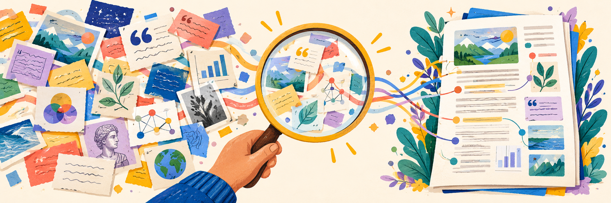

# Harness Research

**Turn a topic or a set of documents into a clear, cited research report.**

Harness Research is a skill for Codex, Claude Code, and Cursor. Your agent gathers
evidence, explains what matters, and saves a report you can use for a decision,
presentation, blog, or training.

## Get started

You need **Node.js 20+**, Git, Bash, and an agent with tools to search and read
sources. The skill uses your agent’s existing model and tools.

### 1. Install the skill

Run these commands in a terminal to install the stable release:

```sh
git clone --branch v1.0.0 https://github.com/dbbaskette/harness-research-skill.git
cd harness-research-skill
bash scripts/Install-Harness-Research.sh
```

The installer makes the skill available to Codex, Claude Code, and Cursor.
[Setup and update instructions →](docs/setup.md)

### 2. Open your project and ask

Return to the project where you want the research saved, then start a new agent
session. Use **`$harness-research`** in Codex, **`/harness-research`** in Claude
Code, or ask Cursor to use Harness Research.

Describe what you want to learn:

```text
Use Harness Research to compare PostgreSQL and SQLite for a small internal app.
The audience is our engineering team. Use public primary sources and explain
which requirements would change the choice.
```

If you have a purpose, add it: “help us choose,” “background for a blog,” or
“teach engineers new to the topic.” Otherwise, the agent prepares a general
overview. It handles source collection, citations, writing, and saving.

To work only from your own documents:

```text
Use Harness Research to check the launch claims in sources/product-brief.pdf
and sources/release-notes.md. Use only these files. Explain what they support,
where they disagree, and what remains unknown.
```

### 3. Open the result

The agent links the saved files in your project:

| File | What it contains |
| --- | --- |
| **`research/report.md`** | The main answer, supporting explanation, and limitations |
| **`research/brief.md`** | Key takeaways and evidence for the work you plan to do next |
| **`research/evidence.md`** | Source passages, qualifications, and review details |

Source snapshots and JSON exports are saved alongside them for traceability and
reuse. You can ask follow-ups such as “explain this for beginners” or “refresh the
evidence before we use it.”

[See a Valkey/Redis report](docs/verification/1.0.0-alpha.1/valkey-redis-editorial/research/report.md)
and its [presentation brief](docs/verification/1.0.0-alpha.1/valkey-redis-editorial/research/brief.md).

## How review works

A separate agent run checks the sources and conclusions. If independent
review or source access is incomplete, the report clearly shows its draft status
or limitations. A reviewed report can still have open questions, and changing
information may need a refresh.

The report and brief can feed another writing or presentation skill. Research
produces the evidence and explanation; the next skill creates the final content.

## Learn more

- [User guide](docs/using-harness-research.md) — scope, sources, follow-ups, and reuse.
- [Setup and troubleshooting](docs/setup.md) — installation, updates, and older projects.
- [Developer guide](docs/development.md) — CLI commands, testing, and instruction context.
- [Runnable example](examples/synthesis/README.md) — try the development workflow locally.
- [Architecture](docs/architecture.md) and [release history](docs/releases.md).

The synthesis approach adapts Anthropic’s Knowledge Synthesis.
See [attribution and licenses](NOTICE.md).
