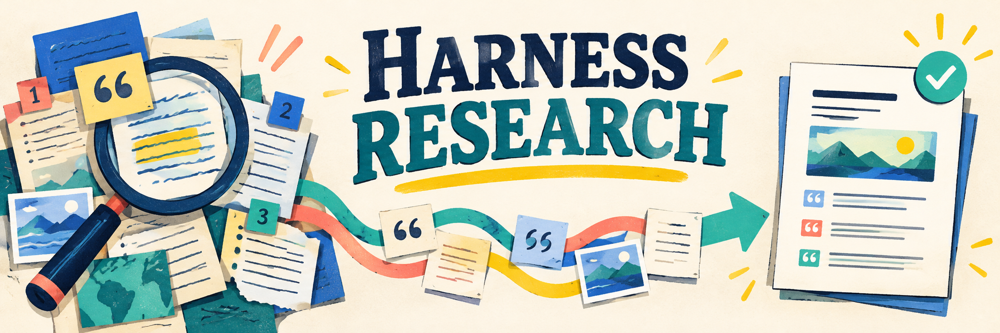

# Harness Research

### Ask a question. Follow the evidence. Keep the report.

A research **skill for Codex, Claude Code, and Cursor**. Give your agent a topic,
selected documents, or claims to check. It reads sources, checks the evidence, and
saves a cited report in your project—ready to open, share, and continue later.

**[Get started](#get-started)** · **[See a report](#see-what-you-get)** ·
**[User guide](docs/using-harness-research.md)** · **[Setup & updates](docs/setup.md)**

| Bring the question | Keep the useful work |
| --- | --- |
| Compare tools or approaches | Findings with source quotes, dates, and a comparison you can inspect. |
| Research your documents | A clear boundary around the sources you selected. |
| Check a set of claims | Supported, contradicted, or insufficient—with the evidence behind each verdict. |
| Return to unfinished research | Saved progress, visible gaps, and a report that survives the chat. |

> **Current release: [0.9.0](https://github.com/dbbaskette/harness-research-skill/releases/tag/v0.9.0).**
> Install the tagged version below. Already using a preview that says 0.9.0?
> Rerun the installer from this tag to get the final release.
> [Versions, updates, and troubleshooting →](docs/setup.md)

## Get started

### 1. Install the skill

Have **Node.js 20+**, **Git**, **Bash**, and your coding agent ready. The skill uses
your agent's existing research tools and model access. You don't need npm or a
separate research account. Your agent also needs permission to start a separate
checker for the evidence.

```sh
git clone --branch v0.9.0 https://github.com/dbbaskette/harness-research-skill.git
cd harness-research-skill
bash scripts/Install-Harness-Research.sh
```

The installer registers the skill for all three agents. Look for
`"status": "installed"`, then **start a new agent session**.
[Installation locations, tagged releases, and custom setup →](docs/setup.md)

### 2. Open the project where you want your research

Use your own content or code project. This is where the report will be saved.
You can work with public sources, selected documents, or both.

### 3. Ask in plain language

Give your agent a research request:

**Codex**

```text
$harness-research Compare PostgreSQL and SQLite for a small internal application.
Use public primary sources. Cover deployment, concurrency, and maintenance.
```

**Claude Code**

```text
/harness-research Compare PostgreSQL and SQLite for a small internal application.
Use public primary sources. Cover deployment, concurrency, and maintenance.
```

**Cursor**

```text
Use the harness-research skill to compare PostgreSQL and SQLite for a small
internal application. Use public primary sources and cover deployment,
concurrency, and maintenance.
```

Your agent handles planning, source reading, helper commands, and saving the
report. If your host asks for permission to run an independent checker, allow it
to complete the checked workflow. No extra “write the report” request is needed.

**Working from your own files?** Try:

```text
$harness-research Read sources/product-brief.pdf and sources/release-notes.md.
Using only these documents, check which launch claims are supported.
Keep contradictions and missing evidence visible.
```

[More examples: deep research, claim checks, and planning first →](docs/using-harness-research.md#prompts-to-start-from)

## See what you get

The main deliverable is **`research/report.md`**: questions and answers, cited
headlines, source quotes, comparisons, and explicit gaps. It's saved as work
progresses, so a partial report is available while research is underway.

```text
your-project/
└── research/
    ├── report.md       Read the findings and their evidence
    ├── facts.json      Inspect structured facts, citations, and history
    ├── brief.md        Reuse the current checked facts as context
    ├── plan.json       Inspect the agreed scope and questions
    ├── plan.md         Read the plan in Markdown
    └── output.json     Identify the export revision and file hashes
```

Open a recorded development example:

- **[Redis vs Valkey](docs/verification/0.9.0/claude-code-redis-valkey/new/research/report.md)** —
  a broader Claude Code trial with 113 checked facts; [comparison notes](docs/verification/0.9.0/claude-code-redis-valkey/README.md) explain its limits.

- **[PostgreSQL vs SQLite](docs/verification/0.9.0/public/research/report.md)** —
  a narrow comparison using public primary documentation.
- **[AsterDB vs BirchDB](docs/verification/0.9.0/supplied/research/report.md)** —
  synthetic supplied documents, including two questions the sources cannot answer.

[Understand the files, statuses, and limits →](docs/using-harness-research.md#read-the-result)

## How the evidence gets checked

**Plan → research → independent check → cross-check → write.**

A separate invocation reads the original supporting material and can confirm,
narrow, or reject a candidate fact. The helper checks source revisions, quote
placement, citation references, and numbers. Unanswered questions stay visible;
an unavailable checker produces a blocked partial report.

The default **light** depth checks facts. **Standard** and **deep** also require
an independent review of the written answers. Checked support means the cited
source supports the statement; it does not certify the source as true or current.

[Depths, source handling, and the checking process →](docs/using-harness-research.md#choose-the-depth)

## Pick it up later

Open the same project and ask:

```text
$harness-research Continue the saved research in this project.
Check for changed sources and work through the remaining questions.
```

Saved tasks keep their guidance and runtime. Changed evidence is marked stale;
your agent will explain what needs reassessment.
[Resume, changed sources, and recovery →](docs/using-harness-research.md#continue-or-recover-a-run)

## Find your next step

| I want to… | Open… |
| --- | --- |
| Install, update, check my version, or fix setup | [Setup & troubleshooting](docs/setup.md) |
| Choose sources, write a better prompt, or understand the report | [Using Harness Research](docs/using-harness-research.md) |
| Understand helpers, schemas, or run tests | [Developer guide](docs/development.md) |
| Continue older Tanzu Brand research | [Migration guide](references/migration.md) |
| Inspect the agent's workflow | [Skill instructions](SKILL.md) and [research contract](references/research-run.md) |
| See what has been verified | [Development evidence and release decision](docs/verification/0.9.0/README.md) |

## Built for your agent, with the work kept in your project

The skill uses your harness's tools and judgement. A Node.js helper tracks tasks,
evidence, and saved outputs. Core use needs no new service, research subscription,
or Python environment. Your normal agent/model usage still applies.

MIT licensed. See [the license](LICENSE), [credits and adaptations](NOTICE.md),
and [the changelog](CHANGELOG.md). Maintainers: [release procedure](docs/releases.md).

<details>
<summary>For maintainers: measured instruction context</summary>

The skill loads the references needed for the selected workflow. These generated
measurements cover instructions, excluding source content and conversation.

<!-- CONTEXT-USAGE:START -->
Measured with `cl100k_base`; cumulative instruction counts, including a normalized
representative guidance-start response. Bootstrap activation is shown separately.

| Reading path | Tokens |
| --- | ---: |
| Discovery metadata | 38 |
| Installed bootstrap | 490 |
| Bootstrap + current guidance entry | 1,093 |
| Skill research with independent checks and saved report | 4,506 |
| Explicit chat-only cited answer | 2,047 |
| Legacy manual research with saved report | 3,238 |
| Status / resume without new findings | 1,648 |
| Comparative routing only | 1,800 |
| Codex comparative outline | 2,760 |
| Codex add items | 1,965 |
| Codex add fields | 1,985 |
| Codex deep results | 2,648 |
| Codex deep results + saved evidence | 3,839 |
| Claude comparative outline | 2,777 |
| Claude deep results | 2,670 |
| Saved research + general web strategy | 5,003 |
| Saved research + academic strategy | 5,095 |
| Saved research + GitHub strategy | 4,890 |
| Saved research + technical Q&A strategy | 4,795 |
| Saved research + Chinese sources strategy | 5,020 |
| Legacy migration | 1,442 |

Comparative rows include the selected platform resource, not the complete bundle.
Each strategy row includes one router and one strategy. Status/resume skips plan
and finding schemas until a new save is needed. Only explicitly requested chat-only
answers omit saved artifacts; default research uses the skill task/evidence workflow. Source
content, images, research task responses and conversation add separately. The JSON
report also exposes direct-handoff paths without the bootstrap/start response.
<!-- CONTEXT-USAGE:END -->

Run `npm run context:update` after instruction changes and
`npm run context:check` to check the measurements. See the [developer guide](docs/development.md).

</details>
