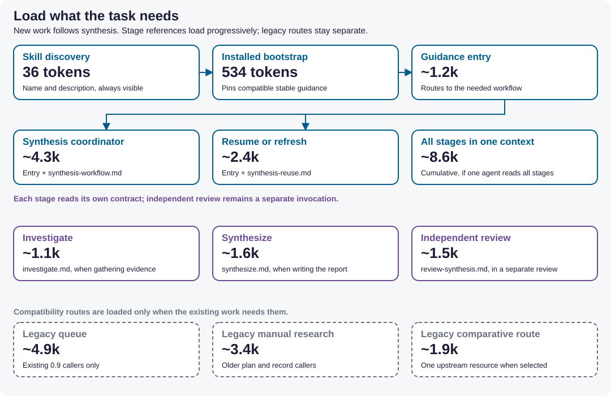

# Harness Research

### Find the evidence. Connect the ideas. Keep the understanding.

A research **skill for your coding agent**. Ask about a topic, compare options, or
bring documents to examine. Get a saved, cited report that explains what matters,
why it matters, and where the evidence stops—ready to inform a presentation,
a blog, training, or a decision.

**[Start here](#your-first-research-report)** · **[What you get](#what-you-get)** ·
**[User guide](docs/using-harness-research.md)** · **[Setup](docs/setup.md)**

> **Harness Research 1.0.** The synthesis-first workflow is available in
> [v1.0.0](https://github.com/dbbaskette/harness-research-skill/releases/tag/v1.0.0).
> Upgrade the installed runtime to use it for new research. Existing 0.9 projects
> keep their pinned runtime and guidance. [Migration details →](docs/migration-v1.md)

## Your first research report

You need **Node.js 20+** and an agent with source-reading/search tools, such as
Codex or Claude Code. The agent uses its existing tools and model access; there
is no separate research service or API subscription to configure. A checked report
also needs a separate agent invocation to review the evidence and synthesis.

### 1. Open a project for the output

Choose the content or code project where you want `research/report.md` saved.
For your first run, use a new folder so existing research stays intact.

### 2. Install the skill and ask your agent

Install once, or run the installer from the new release to upgrade:

```sh
git clone --branch v1.0.0 https://github.com/dbbaskette/harness-research-skill.git
cd harness-research-skill
bash scripts/Install-Harness-Research.sh
```

Start a new agent session. Invoke **`$harness-research`** in Codex,
**`/harness-research`** in Claude Code, or ask Cursor to use Harness Research:

```text
Use Harness Research to compare Valkey and Redis for an application engineering
team considering replacing Redis. Use public primary sources. Explain where
replacement is practical, where it is risky, and what to verify before migration.
```

The agent handles source collection, helper commands, writing and saving. You do
not need to prepare JSON, run npm commands, request citations, or ask it to write
the report afterward. If your host requests permission for an independent review,
allow it to complete the checked workflow.

[Install, update and version details →](docs/setup.md)

### 3. Open the result

The agent links **`research/report.md`**. Read the central answer, findings,
explanation, comparisons and limitations. Follow the evidence links when you want
to inspect the underlying source passages.

If source access or independent checking is incomplete, the saved output says so.
A draft is useful progress; it is not presented as a completed checked report.

## What you get

Research organized for understanding, with the audit trail close at hand.

| File | Use it for |
| --- | --- |
| `research/report.md` | The main answer, themes, findings, explanations and comparisons |
| `research/brief.md` | A prioritized handoff shaped to your task, with useful evidence and qualifications to retain |
| `research/evidence.md` | Source passages and the factual support behind the report |
| `research/facts.json` | Structured evidence and synthesis for compatible tools (schema 2) |
| `research/output.json` | The saved revision, review status and artifact hashes |
| `research/sources/` | Pinned source text used for this result |

Questions guide the investigation. They do not force every report into Q&A.
A short factual check can stay short; a broad topic can become a coherent
explanation. A comparison uses named criteria rather than unrelated fact lists.

Read the [Valkey/Redis replacement report](docs/verification/1.0.0-alpha.1/valkey-redis-editorial/research/report.md):
a revised example with 21 primary sources, 38 facts and five synthesized findings,
independently checked against dated source captures and saved original contexts.
Its [prioritized presentation brief](docs/verification/1.0.0-alpha.1/valkey-redis-editorial/research/brief.md)
shows the task-shaped handoff. The
[editorial refinement record](docs/verification/1.0.0-alpha.1/editorial-refinement/README.md)
documents review, tests and current studio integration limits; the
[initial acceptance record](docs/verification/1.0.0-alpha.1/README.md) preserves history.
Earlier [0.9 examples](docs/verification/0.9.0/README.md) document the previous
implementation and are not examples of this output contract.

## Start with your purpose

Add the purpose in your own words: “help us choose,” “background for a blog,” or
“teach engineers new to the topic.” It shapes the depth, explanations and format
of the report and brief. If you leave it out, the default is **general-purpose
topic research**: a balanced explanation of the topic and a concise overview.
No intake form is required. You can name more than one use and say which matters
most. A studio can pass its actual content task as the purpose.

**Understand a topic**

```text
Research how retrieval-augmented generation works for software architects.
Explain the mechanisms, trade-offs, failure modes and evaluation choices.
Use public primary sources. This will inform a technical blog and training.
```

**Compare alternatives**

```text
Compare PostgreSQL and SQLite for a small internal application.
Cover deployment, concurrency and maintenance. Explain which constraints
change the decision, and leave unknown workload requirements visible.
```

**Work only from your documents**

```text
Use sources/product-brief.pdf and sources/release-notes.md only.
Check which launch claims they support, explain contradictions, and identify
what remains unknown. The audience is our technical enablement team.
```

After installing a published version, invoke **`$harness-research`** in Codex,
**`/harness-research`** in Claude Code, or ask your agent to use the named skill.
New tasks select compatible stable guidance automatically; existing tasks keep their pins.

[More on scope, source choices and follow-ups →](docs/using-harness-research.md)

## Useful input for the work that comes next

The brief leads with what matters for the task and selects the strongest useful
support. Its shape can change with the intended use:

- **Presentations:** key messages, a possible storyline and evidence worth visualizing.
- **Blogs:** a central argument, mechanisms and the strongest counterarguments.
- **Training:** a concept sequence, misconceptions and grounded examples.
- **Decisions:** consequential tradeoffs and conditions that change the choice.

These are useful emphases, not fixed templates or a bundle of separate deliverables.
The next skill still owns the slides, prose or lesson design. A research report
is a derived artifact, not a new independent primary source. Structured consumers
must support schema 2 explicitly; [migration notes](docs/migration-v1.md) explain
what changes and what remains available. [Passing a studio task →](docs/using-harness-research.md#feed-presentations-blogs-and-training)

## How it works

**Investigate → connect the evidence → write → independently review → save.**

The synthesis approach adapts Anthropic's
[Knowledge Synthesis](https://github.com/anthropics/knowledge-work-plugins/tree/33eeda1e8fd856455b05479d13a0f85b5f803744/enterprise-search/skills/knowledge-synthesis):
group related evidence, prioritize what the reader needs, preserve disagreement,
and lead with a useful answer. Harness adds scoped investigation, saved evidence,
independent review and durable output. [Attribution and licenses →](NOTICE.md)

The agent does the thinking. A local helper checks quotations and references,
pins source text, and ties review to the exact saved evidence. A different
invocation checks both the factual support and the conclusions drawn from it.
Source support is not a guarantee of truth or live currency.

The skill loads guidance **only when that stage needs it**. Investigation,
synthesis, checking and reuse have focused references; old queue instructions
are loaded only to resume old work.



[Architecture](docs/architecture.md) · [Evidence and limitations](docs/using-harness-research.md#evidence-and-review) ·
[Developer guide](docs/development.md) · [Release history](docs/releases.md)

<details>
<summary>For maintainers: measured instruction context</summary>

<!-- CONTEXT-USAGE:START -->
Measured with `cl100k_base`; cumulative instruction counts include a normalized
representative guidance-start response. Stage-only rows count their own reference.

| Reading path | Tokens |
| --- | ---: |
| Discovery metadata | 36 |
| Installed bootstrap | 521 |
| Bootstrap + current guidance entry | 1,183 |
| Investigator stage | 1,017 |
| Synthesis writer stage | 1,547 |
| Independent reviewer stage | 1,330 |
| New synthesis: coordinator entry and workflow | 3,708 |
| New synthesis: all stages in one context | 7,602 |
| Synthesis resume, verify or refresh | 2,067 |
| Optional studio task handoff | 4,409 |
| Legacy 0.9 queued coordinator | 4,908 |
| Legacy 0.9 reuse or refresh | 1,960 |
| Legacy explicit chat-only answer | 2,137 |
| Legacy manual saved research | 3,328 |
| Legacy manual status or resume | 1,738 |
| Legacy comparative routing only | 1,890 |
| Legacy Codex comparative outline | 2,850 |
| Legacy Codex add items | 2,055 |
| Legacy Codex add fields | 2,075 |
| Legacy Codex deep results | 2,738 |
| Legacy Codex deep results + saved evidence | 3,929 |
| Legacy Claude comparative outline | 2,867 |
| Legacy Claude deep results | 2,760 |
| Investigation + general web strategy | 5,222 |
| Investigation + academic strategy | 5,314 |
| Investigation + GitHub strategy | 5,109 |
| Investigation + technical Q&A strategy | 5,014 |
| Investigation + Chinese sources strategy | 5,239 |
| Legacy migration | 1,532 |

The new default starts with the entry and synthesis workflow. Investigation, writing
and independent review each load their own reference when needed. The all-stages
row shows their cumulative cost if read in one context; delegated stage rows are
separate contexts. Synthesis reuse does not load investigation or writing contracts
until new work is needed. Strategy rows add exactly one source strategy. Legacy
queue, manual and comparative paths remain available only for existing callers.
Source documents, evidence payloads, tool responses and conversation add separately.
The JSON output also exposes direct-checkout paths without bootstrap/start overhead.
<!-- CONTEXT-USAGE:END -->

Measurements describe instruction loading, not total model usage or cost.
Run `npm run context:update` after guidance changes and `npm run context:check`
to verify the generated table and map.
</details>
