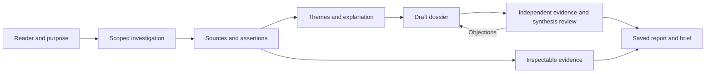

# Architecture: the skill leads, the helper preserves

[README](../README.md) · [Developer guide](development.md) · [Migration](migration-v1.md)

Harness Research 1.0 starts from Anthropic's Knowledge Synthesis rather than a
queue of questions. The agent investigates, groups and weighs evidence, explains
its implications, and writes for the intended reader. The helper implements
reliable storage and explicit validation around that work.

## The unit of work is a dossier

The schema-2 dossier has sources, facts, findings, ordered report sections and
optional authored brief sections.
Questions can help the investigator discover missing information; they are not
required public headings or executable tasks. Explicit comparison criteria relate
subject cells instead of pairing facts by array position.

Facts cite exact source quotations and their author identities. Findings connect
facts, identify contrary evidence, and distinguish direct summaries, inferences
and conditional recommendations. Authors use them to shape a prioritized brief
for the actual studio task or research purpose. The helper preserves authored
order and references; it does not choose a format by matching purpose keywords.
Old dossiers without authored brief sections retain the full finding view.
Source limitations and unresolved questions remain explicit, including unknown
workload details that more web searching cannot resolve.

The [schema](../references/synthesis.schema.json) is a reference for agents and
integrators. The runtime validates semantic relationships such as reference
existence and comparison subject coverage; an independent reviewer judges the
actual meaning and usefulness.

## Review is tied to content

Saving computes a digest over the dossier, its author and source hashes. The
independent review names that digest and the inspected sources. It assesses
facts, findings, report and brief prose, comparison cells, coverage and usefulness. An author
cannot review their own dossier or their own facts under the same identity.

The host supplies identities and reading attestations. The helper can reject a
recorded identity collision or stale digest; it cannot prove that an agent ran,
read honestly, or reasoned correctly. Separate invocations can still share biases.
This is why the skill instructs an actual source and semantic review, and why
mechanical validation is never described as fact certification.

## States and output ownership

- `draft`: saved work awaits independent review.
- `needs-revision`: a submitted review raises an objection or cannot inspect evidence.
- `stale`: the dossier/evidence no longer matches its recorded integrity state.
- `complete`: the review accepts the current evidence and synthesis, with accurately described gaps still possible.

The helper owns its generated output files after a valid first save. It refuses
unowned files, nonregular output paths and a project already owned by the old
research engine. Status/verify can regenerate derived artifacts and report that
repair, preserving prior bytes in `.harness-research/output-backups/` and
returning backup paths. Full finding qualifications remain in the evidence
appendix even when the brief selects a smaller view. Source changes require a new save and review, not a repaired approval.

Source snapshots and generated files remain with the research. Working dossiers,
review input and planning notes are agent-managed inputs; only manifest-listed
artifacts are part of the committed output set. A copied result is inspectable,
but continuing it requires the saved project state and compatible runtime.

## Progressive disclosure is a behavior

| When | Read |
| --- | --- |
| Discovery | Skill name and description |
| Activation | Short entrypoint and the selected workflow |
| Gathering evidence | Investigation reference |
| Organizing and writing | Synthesis reference |
| Independent checking | Review reference and exact review template |
| Revisiting saved work | Reuse reference |
| Existing legacy project | Its legacy workflow and the needed task contract |

A coordinator can encounter several stages over a long run. That does not mean
every worker loads the entire instruction library. The generated context map
measures stage paths and cumulative loading separately; it does not estimate total
research tokens or cost. [Measured map](images/context-loading.svg)

## What remains from 0.9

Existing queue and manual commands are preserved for old projects. Their schemas,
checks and release evidence remain versioned history. They do not orchestrate new
synthesis dossiers. Existing structured consumers require an explicit schema-2
adapter; Markdown report/brief reuse is the straightforward first integration.

The detailed [approved implementation specification](superpowers/specs/2026-10-17-synthesis-first.md)
records boundaries and acceptance. [NOTICE](../NOTICE.md) identifies the upstream
instructional foundation and retained compatibility sources.
