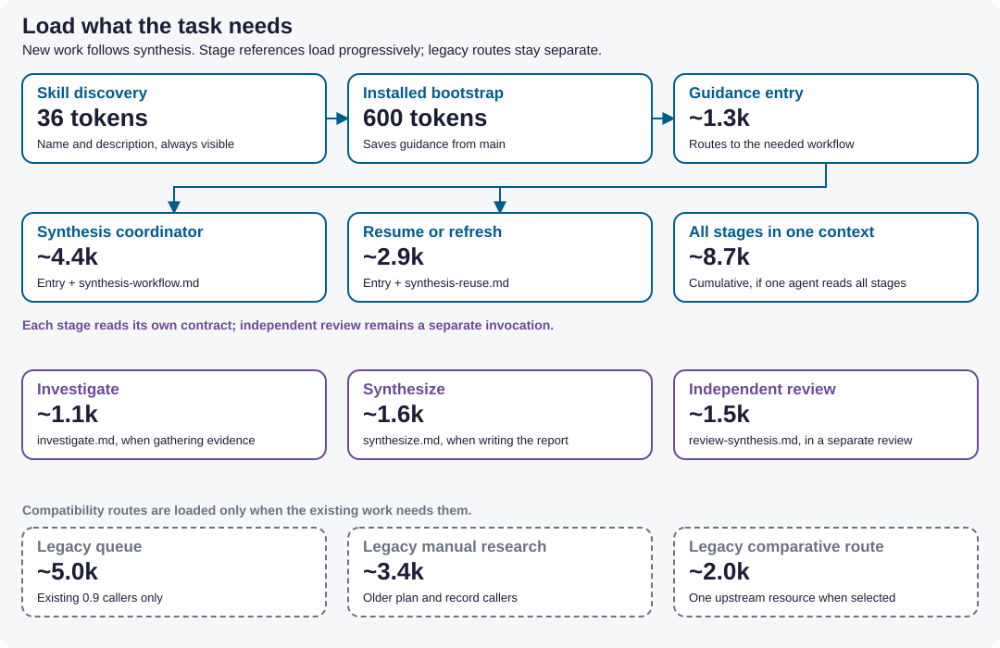

# Developing Harness Research

[README](../README.md) · [Architecture](architecture.md) · [Migration](migration-v1.md)

The public interface is a skill invocation. These commands are for maintainers
and agents; first-time users do not need to drive them.

## Code and instruction map

| Area | Files |
| --- | --- |
| Discovery and stage routing | [SKILL.md](../SKILL.md) |
| Coordinator and dossier contract | [synthesis-workflow.md](../references/synthesis-workflow.md) |
| Investigation / writing / review | [investigate.md](../references/investigate.md), [synthesize.md](../references/synthesize.md), [review-synthesis.md](../references/review-synthesis.md) |
| Local assets and input inventory | [topic-assets.md](../references/topic-assets.md), `scripts/lib/topic-assets.mjs` |
| Bounded collection and worker packets | [parallel-research.md](../references/parallel-research.md), [investigation-packet.md](../references/investigation-packet.md) |
| Independent review in units | [review-units.md](../references/review-units.md), [review-unit.md](../references/review-unit.md), `scripts/lib/review-units.mjs`, `scripts/lib/review-units-model.mjs`, [review-units.schema.json](../references/review-units.schema.json) |
| CLI, state, snapshots and repairs | [synthesis-cli.mjs](../scripts/lib/synthesis-cli.mjs) |
| Validation and review binding | [synthesis-model.mjs](../scripts/lib/synthesis-model.mjs) |
| Report, brief, evidence and exports | [synthesis-output.mjs](../scripts/lib/synthesis-output.mjs) |
| JSON contracts | [synthesis.schema.json](../references/synthesis.schema.json) |
| Packaging and compatibility | [install.mjs](../scripts/install.mjs), [sync-guidance.mjs](../scripts/sync-guidance.mjs) |
| Prior queue and manual interface | [legacy developer guide](legacy-development.md) |

## Local asset and collection development

Version `1.1.0` added local topic assets and bounded evidence collection.
Installed tasks take their guidance from `main`. To try changes that are not on
`main` yet, select the checkout's `SKILL.md` and runtime explicitly.

Create a topic asset from a directory/URL-list intake:

```sh
node scripts/harness-research.mjs asset init --project /absolute/workspace --topic "Example topic" --directory /absolute/inputs --source-mode selected
```

The returned root defaults to `/absolute/workspace/research/example-topic`.
`--destination` selects a local output root; no Git operation or studio is required.
Use that root as `--project` for normal synthesis commands, with `dossier.json`
and `review.json` relative to it. Its owned marker writes generated artifacts at
the root. Existing unmarked cases retain `<project>/research/` paths.
`asset help` describes metadata, intake, source-outcome and status operations.
After synthesis verification, the asset handoff manifest hashes metadata, source
inventory, retained originals/captures and reviewed bundle artifacts. It excludes
private helper state. Metadata updates change the handoff manifest without
claiming a new semantic review or changing the dossier's reviewed digest.

For bounded investigation, author the request and use:

```sh
node scripts/harness-research.mjs collection init --project /absolute/asset --file request.json
node scripts/harness-research.mjs collection register --project /absolute/asset --file invocation.json
node scripts/harness-research.mjs collection capture --project /absolute/asset --file capture.json
node scripts/harness-research.mjs collection accept --project /absolute/asset --file packet.json
node scripts/harness-research.mjs collection assemble --project /absolute/asset
```

See [coordination](../references/parallel-research.md) for host-controlled identities,
receipt fields and attempt/generation transitions. The helper performs local
validation and persistence only. Native host calls run investigators and control
budget/cancellation. Register asset source outcomes before collection capture.
The host records actual invocation termination through `collection finish`; a
stop/retry request alone is not evidence that a process stopped. Use returned registry records unchanged as dossier sources
and facts; findings, report and brief remain authored synthesis. The standard
saved-digest independent review is still the final boundary.

## Work with an existing project dossier

Use a fresh content project. Copy/read source material into it through the host's
authorized tools, then author a dossier using the [contract](../references/synthesis-workflow.md).
Paths passed through `--file` are relative to `--project`.

```sh
node scripts/harness-research.mjs synthesis help
node scripts/harness-research.mjs synthesis save --project /absolute/content-project --file research/dossier.json --worker researcher
node scripts/harness-research.mjs synthesis status --project /absolute/content-project --compact
```

Validate a dossier without writing or clearing an existing review:

```sh
node scripts/harness-research.mjs synthesis validate --project /absolute/content-project --file research/dossier.json --worker researcher
node scripts/harness-research.mjs synthesis template --project /absolute/content-project --out research/review.json
```

`--compact` returns status, digest, counts, integrity checks, problems and repair
paths. Full responses remain the default for existing consumers and include
source records and `review_template`; `--verbose` pretty-prints the full result.
`template` prints only pending review JSON, or creates a new project-relative
`--out` file under an existing directory. It refuses overwrites and managed paths.
A different invocation reads the source context and saved report, fills the
template, and submits its real judgments:

```sh
node scripts/harness-research.mjs synthesis review --project /absolute/content-project --file research/review.json --worker reviewer
node scripts/harness-research.mjs synthesis verify --project /absolute/content-project
```

A host may instead split the review into units (protocol `harness-review-units-v1`,
declared in `references/review-units-capability.json`):

```sh
node scripts/harness-research.mjs review-units plan --project /absolute/content-project
node scripts/harness-research.mjs review-units register --project /absolute/content-project --file registration.json
node scripts/harness-research.mjs review-units assign --project /absolute/content-project --unit UNIT --out research/unit.json
node scripts/harness-research.mjs review-units accept --project /absolute/content-project --file research/unit-answer.json
node scripts/harness-research.mjs review-units assemble --project /absolute/content-project
```

The [host page](../references/review-units.md) gives the full sequence. An assembled
review is held in synthesis state schema 4, which runtimes before 1.6.0 refuse.

Worker strings identify actual invocations; they are not role-switching switches.
Read the [review guide](../references/review-synthesis.md) before checking. A review
cannot approve a different digest. Invalid references, source changes and missing
review items are actionable errors, not reasons to weaken the contract.

`status` and `verify` inspect local integrity and repair derived exports when
needed; their results identify repaired files and `preserved_files` backup paths.
Every overwritten output, including normal status transitions, is preserved
byte-for-byte under `.harness-research/output-backups/`, deduplicated by content.
Backups are working history outside the portable artifact manifest. Bring useful
edits back into the dossier and save/review them. Integrity checks deduplicate
source paths within each command and report `integrity_checks` with files checked
and bytes hashed; the next command reads the bytes again. Neither browses or revalidates
current websites. Saving revised content clears the old review. Preserve source
and dossier history and obtain a new review after material changes.

CLI exits are intentionally separate from completion:

| Result | Exit |
| --- | ---: |
| Intact draft or intact needs-revision on status/verify | 0 |
| Completed output or accepted review | 0 |
| Stale evidence or failed artifact integrity | 1 |
| Submitted review with objections | 1 (objections are saved) |
| Invalid command/input or storage failure | 1 |

For completion gates, check `status === "complete"` as well as the exit code.
See the [executable schema-2 example](../examples/synthesis/README.md) for a small
source, dossier, authored brief and unfilled review template. It uses no network
or automatic passing review.

## Development and installation

Everything is served from `main`: users install from `main`, and `start` always
takes the guidance on `refs/heads/main` of the trusted repository. Release tags
are not listed or selected. When `main`'s guidance declares a `minimumRuntime`
newer than the installed runtime, `start` is refused with the update message, and
the fix is to update the installation from `main`. So merge guidance and the
runtime it needs together, and keep `guidance/manifest.json`'s `minimumRuntime`
equal to the package version (a test enforces it). `pin --revision` accepts only a
commit on `main`. New pins record `channel: "main"` and `ref: "refs/heads/main"`;
pins from earlier versions with `channel: "release"` and a tag `ref` resume
unchanged. To try changes that are not on `main` yet, select the checkout's
`SKILL.md` and runtime explicitly. Guidance refresh never upgrades executable
helpers or changes an existing task's saved guidance.

Nothing is tied to one installed version. A task pin saves the guidance snapshot
and, for information, the runtime version and guidance floor it started with;
`resume` and `cached` return the installed runtime at its stable address,
`<shared>/current`, with a `notice` when its version differs, and refuse only when
the saved guidance needs a newer runtime. Pins from before 1.3.0 also carry
`runtime`, `runtimeFiles` and an exact `runtimeVersion`; these are read without a
migration and not checked. Unchanged-save receipts bind the host's context only,
and a `runtime_digest` in an older receipt is ignored. The installer returns
`runtime` (the stable address), `id` and `versionDirectory` (the folder an update
replaces), removes every other entry in `versions/` after the pointer moves, and
lists what it removed and what it could not remove. Do not store or compare an
installed path, version or file hash as a condition for continuing work.

Test an installation only in disposable destinations:

```sh
bash scripts/Install-Harness-Research.sh --home /absolute/disposable-home --shared /absolute/disposable-runtime
```

The installer bundles skill references, runtime and upstream attribution without
runtime npm dependencies. Fetched guidance contains instructions and licenses,
not executable repository code. [Setup](setup.md) explains the user-facing paths.

## Verification

Implement a coherent slice, then run affected tests. Main integration verification
owns the full suite; do not repeat it for every instruction or documentation edit.

```sh
npm ci --ignore-scripts
node --test tests/synthesis-runtime.test.mjs
npm run context:update
npm run context:check
npm test
```

The repository's native gate uses a disposable Tart VM and tests installation,
full suite, audit and generated context:

```sh
npm run ci:local
```

Read the host local-CI reference, [wrapper](../scripts/ci/tart-macos.sh), and
[guest script](../scripts/ci/guest-test.sh) before running it. Do not modify or
stop unrelated VMs. Retain logs and verify clone cleanup. Python/PyYAML compatibility
checks belong in the disposable test environment rather than system Python.

Instruction-token measurement is generated by [context-usage.mjs](../tools/context-usage.mjs).
It reports per-stage and cumulative context, not model cost. After guidance changes,
regenerate the table below and its context map, then check them.

The [1.0 acceptance record](verification/1.0.0-alpha.1/README.md) distinguishes code
checks, live research, independent evidence review and limitations. Each release's
record under [verification](verification/) pins its tested tree and scope. A synthetic
fixture is not a live research test, and local acceptance is not a release.

## Documentation and attribution

The [architecture spec](superpowers/specs/2026-10-17-synthesis-first.md) is the new
source of design intent. Older specs are marked historical. Preserve Anthropic's
original and Apache license under `upstream/anthropic/`; [NOTICE](../NOTICE.md)
records modifications and attribution. The project otherwise retains its existing
license and legacy notices.

The README illustration was generated with the built-in image tool and saved as
[the new banner](assets/harness-research-synthesis-banner.png); its
[prompt and tool provenance](assets/synthesis-banner-prompt.txt) are committed
alongside it. It is a documentation asset, not an instruction input.

## Instruction context

The skill loads the entrypoint and the references needed for the current stage.
These generated measurements describe instruction loading, not total model usage
or cost. Source documents, tool responses, and conversation add separately.



<!-- CONTEXT-USAGE:START -->
Measured with `cl100k_base`; cumulative instruction counts include a normalized
representative guidance-start response. Stage-only rows count their own reference.

| Reading path | Tokens |
| --- | ---: |
| Discovery metadata | 36 |
| Installed bootstrap | 600 |
| Bootstrap + current guidance entry | 1,299 |
| Investigator stage | 1,143 |
| Synthesis writer stage | 1,614 |
| Independent reviewer stage | 1,528 |
| Review unit reviewer stage | 2,027 |
| New synthesis: coordinator entry and workflow | 4,411 |
| New synthesis: all stages in one context | 8,696 |
| Synthesis resume, verify or refresh | 2,877 |
| Optional studio task handoff | 5,583 |
| Optional local topic asset intake | 5,970 |
| Parallel coordinator with Codex adapter | 5,977 |
| Parallel coordinator with Claude Code adapter | 5,961 |
| Review units coordinator | 5,715 |
| Delegated investigator with packet contract | 2,278 |
| Legacy 0.9 queued coordinator | 5,042 |
| Legacy 0.9 reuse or refresh | 2,076 |
| Legacy explicit chat-only answer | 2,253 |
| Legacy manual saved research | 3,444 |
| Legacy manual status or resume | 1,887 |
| Legacy comparative routing only | 2,006 |
| Legacy Codex comparative outline | 2,966 |
| Legacy Codex add items | 2,171 |
| Legacy Codex add fields | 2,191 |
| Legacy Codex deep results | 2,854 |
| Legacy Codex deep results + saved evidence | 4,045 |
| Legacy Claude comparative outline | 2,983 |
| Legacy Claude deep results | 2,876 |
| Investigation + general web strategy | 6,051 |
| Investigation + academic strategy | 6,143 |
| Investigation + GitHub strategy | 5,938 |
| Investigation + technical Q&A strategy | 5,843 |
| Investigation + Chinese sources strategy | 6,068 |
| Legacy migration | 1,648 |

The new default starts with the entry and synthesis workflow. Investigation, writing
and independent review each load their own reference when needed. The all-stages
row shows their cumulative cost if read in one context; delegated stage rows are
separate contexts. Synthesis reuse does not load investigation or writing contracts
until new work is needed. Strategy rows add exactly one source strategy. Legacy
queue, manual and comparative paths remain available only for existing callers.
Source documents, evidence payloads, tool responses and conversation add separately.
The JSON output also exposes direct-checkout paths without bootstrap/start overhead.
<!-- CONTEXT-USAGE:END -->

Run `npm run context:update` after guidance changes, then `npm run context:check`
to verify the generated table and map.
